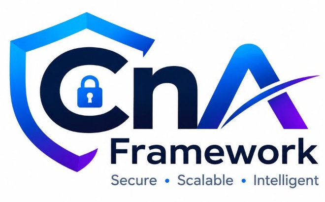

<p align="center">
  
</p>

<p align="center">
  <strong>The Contract-Driven PHP Framework • Version 2.0</strong><br>
  <em>Secure • Scalable • Intelligent • Modern Frontend Engine</em>
</p>

<p align="center">
  <a href="https://packagist.org/packages/alan2k2/cna-framework"></a>
  <a href="https://packagist.org/packages/alan2k2/cna-framework"></a>
  <a href="https://alan2k2.github.io/CnA-Framework/"></a>
  <a href="https://github.com/Alan2k2/CnA-Framework/actions"></a>
  <a href="https://www.php.net/"></a>
  <a href="LICENSE"></a>
  <a href="https://owasp.org/www-project-application-security-verification-standard/"></a>
  <a href="https://vite.dev/"></a>
</p>

---

## 🌟 About CnA Framework (Version 2.0)

**CnA Framework** is a contract-driven, high-performance PHP 8.4+ modular monorepo framework built for mission-critical web applications, high-throughput APIs, modern interactive user interfaces, and background worker systems. It pairs the beloved developer ergonomics of Laravel with strict architectural boundaries, native OWASP ASVS Level 2 defenses, zero-leak dependency injection, built-in $O(1)$ eager loading with N+1 query prevention, a provider-independent AI subsystem, and a **first-class Vite-powered Frontend Engine**.

### 👨‍💻 Framework Architect & Lead Developer
- **Author**: **Alan Shaju** (Senior Software Engineer)
- **LinkedIn**: [https://www.linkedin.com/in/alanshaju2k2/](https://www.linkedin.com/in/alanshaju2k2/)
- **GitHub**: [https://github.com/Alan2k2](https://github.com/Alan2k2)

---

## ⚡ Quick Start & Running the Welcome Interface

### 🌐 Live Online Demo (No Installation Required)
You can directly assess the framework UI, features, commands, and interactive API sandbox online:
👉 **[https://alan2k2.github.io/CnA-Framework/](https://alan2k2.github.io/CnA-Framework/)**

---

### Local Installation & Running:

### 1. Clone & Setup
```bash
git clone https://github.com/Alan2k2/CnA-Framework.git
cd CnA-Framework
```

### 2. Environment Setup
```bash
cp .env.example .env
php cna key:generate
```

### 3. Start the Development Server
```bash
php cna serve
```
*(or on Windows: `cna serve`)*

### 4. Access the Welcome Interface
Open your browser and navigate to:
👉 **[http://127.0.0.1:8000](http://127.0.0.1:8000)**

Visiting this URL displays the **CnA Framework Interactive Interface (`welcome.php`)** featuring:
- Official glowing logo and responsive dark theme UI.
- Interactive **Architecture & Request Lifecycle Explorer**.
- Comprehensive breakdown of all **27 Decoupled Packages**.
- Searchable **CLI Command Reference**.
- Interactive **Core Helper Functions Guide**.
- **Live API Playground** allowing you to test endpoints directly from the browser!

---

## 🚀 Key Highlights & Architecture

CnA Framework is built strictly according to enterprise software engineering standards:

1. **Strict Layered Architecture**:
   - Thin transport controllers parse/validate input, invoke application use cases, and serialize responses.
   - Application use cases coordinate business rules and own explicit transaction boundaries via `TransactionManagerInterface`.
   - Domain rules and repository interfaces are completely decoupled from HTTP transport and PDO infrastructure.

2. **First-Class N+1 Prevention & Query Observability**:
   - Strict mode in development/testing throws `LazyLoadingViolationException` on unexpected dynamic lazy loading.
   - Fast $O(1)$ eager loading via `Model::with(['user', 'items'])->get()`.
   - Built-in `QueryObserver` with normalized SQL fingerprinting, repeated relation query detection, and route/job query budgets.

3. **OWASP ASVS Level 2 Baseline Security**:
   - AEAD authenticated encryption (AES-256-GCM) with tag verification and key rotation.
   - Argon2id password hashing by default with Bcrypt fallback.
   - Constant-time secret/token comparisons (`hash_equals`).
   - Automated SSRF defenses blocking private/loopback/metadata IP ranges (127.0.0.0/8, 10.0.0.0/8, 192.168.0.0/16, 169.254.169.254, ::1).
   - Strict SQL parameter binding and dialect identifier quoting (SQLite, MySQL, PostgreSQL).
   - Secure HTTP response headers (HSTS, CSP, X-Frame-Options, X-Content-Type-Options).

4. **Provider-Independent AI Subsystem**:
   - Pluggable provider abstraction (`AIProviderInterface`, `EmbeddingProviderInterface`, `TokenCounterInterface`).
   - Built-in `FakeAIProvider` for deterministic, zero-external-dependency offline testing with recorded chat assertions.
   - `PromptGuard`: Detects prompt injections and redacts sensitive tokens/secrets prior to external transmission.
   - `CostTracker`: Enforces tenant token quotas, approved model allowlists, and usage metrics.
   - `ToolRegistry`: Permissioned tool execution with execution schemas, timeouts, and structured audit trails.
   - `VectorStore`: In-memory RAG vector store with cosine similarity and tenant isolation filtering.

5. **First-Class Frontend Engine & Vite Integration (Version 2.0)**:
   - **Vite Asset Pipeline**: Development HMR on loopback (`http://127.0.0.1:5173`) and fingerprinted production manifest (`.vite/manifest.json`) resolution.
   - **Accessible UI Components**: Built-in server-rendered component catalogue (`ui.button`, `ui.alert`, `ui.badge`, `ui.card`, `ui.input`, `ui.modal`, `ui.table`) with strict HTML escaping.
   - **Feature UI Modules**: Modular frontend architecture under `resources/modules/{name}/`.
   - **React & Vue Adapters**: Optional declarative DOM mount helpers (`ReactAdapter::mount()`, `VueAdapter::mount()`).
   - **Strict Path Security**: Complete protection against path traversal, symlink escapes, and unauthorized origins.

6. **Turnkey CLI Experience (`php cna` or `./cna`)**:
   - Frontend: `frontend:install`, `frontend:dev`, `frontend:build`, `frontend:status`, `frontend:clear`
   - Generators: `make:controller`, `make:service`, `make:repository`, `make:model`, `make:migration`, `make:ui-module`, `make:component`
   - Migrations: `migrate`, `migrate:rollback`, `migrate:refresh`, `db:status`
   - Diagnostics: `doctor`, `route:list`, `db:profile`, `security:check`, `about`
   - AI Diagnostics: `ai:diagnose`, `ai:providers`, `ai:usage`
   - Operations: `serve`, `cache:clear`, `queue:work`, `queue:retry`, `queue:flush`, `schedule:run`, `test`, `benchmark`

---

## 📂 Repository & Monorepo Structure

```
cna-framework/
├── cna                        # CLI executable script
├── cna.bat                    # Windows native CLI launcher
├── server.php                 # Dev server rewrite router
├── vite.config.js             # Vite asset pipeline configuration
├── package.json               # Frontend dependencies & scripts
├── composer.json              # Monorepo composer configuration
├── .env.example               # Environment template
├── packages/                  # 31 Modular Packages (independent composer manifests)
│   ├── contracts/             # Core interfaces (Container, DB, HTTP, AI, View, Frontend, etc.)
│   ├── core/                  # Application engine, pipeline, service providers & helpers
│   ├── container/             # DI container with autowiring, singletons, scoped & circular detection
│   ├── config/                # Dot-notation typed configuration & Env parser
│   ├── console/               # CLI console bus, styling, table renderer & commands
│   ├── http/                  # Normalized Request, Response, JsonResponse & Kernel
│   ├── routing/               # Fluent Router, route groups, named routes, parameter constraints
│   ├── middleware/            # Security headers, CSRF token guard, rate limiter, CORS
│   ├── validation/            # Input validator & typed FormRequest
│   ├── database/              # Multi-driver PDO connection manager & transaction manager
│   ├── query-builder/         # Fluent Query Builder with SQLite/MySQL/PostgreSQL dialects
│   ├── orm/                   # Active Record / Data Mapper hybrid models & relationships
│   ├── migrations/            # Schema builder, blueprints, migration runner & rollbacks
│   ├── auth/                  # Authentication manager, guards & password hashing
│   ├── authorization/         # Gate & RBAC policy system (deny-by-default)
│   ├── security/              # AEAD Encrypter, CSRF manager, SSRF validator, HTML escaper
│   ├── view/                  # Server-rendered layouts, sections & accessible UI components
│   ├── frontend/              # Vite integration, manifest reader, asset resolver & preloads
│   ├── frontend-react/        # Optional React client bootstrapping & mount adapter
│   ├── frontend-vue/          # Optional Vue client bootstrapping & mount adapter
│   ├── cache/                 # Cache manager (array, file, database stores & atomic locks)
│   ├── queue/                 # Queue manager, sync & database drivers, worker daemon
│   ├── events/                # Event dispatcher & subscribers
│   ├── scheduler/             # Cron task scheduler with overlap prevention
│   ├── mail/                  # Mailer abstraction, Mailables & test fakes
│   ├── notifications/         # Multi-channel notification subsystem
│   ├── storage/               # Filesystem abstraction with traversal defense
│   ├── ai/                    # AI Chat, Streaming, Embeddings, RAG, Tools & Safety
│   ├── logging/               # Structured logger with secret redactor & correlation IDs
│   ├── monitoring/            # QueryObserver, query budgets & N+1 detection engine
│   └── testing/               # TestCase, TestResponse, TestRunner & assertions
├── skeleton/                  # Reference application starter (like laravel/laravel)
│   ├── app/
│   │   ├── Http/Controllers/  # Thin transport controllers
│   │   ├── Application/       # Use cases & Commands (e.g. CreateOrderService)
│   │   ├── Domain/            # Entities & Repository Interfaces (Order, User)
│   │   ├── Infrastructure/    # SQL Repository implementations
│   │   └── Models/            # ORM Models (User, Order, OrderItem)
│   ├── bootstrap/app.php      # Application bootstrapping & provider registration
│   ├── config/                # Environment-specific configuration files
│   ├── database/migrations/   # Versioned database migrations
│   ├── public/index.php       # HTTP web entrypoint
│   └── routes/                # api.php and web.php route definitions
├── benchmarks/                # Micro-benchmarks & baseline metrics
├── docs/adr/                  # Architecture Decision Records (ADRs 0001 - 0008)
└── tests/                     # Unit, Feature, and Architecture test suite
```

---

## 🛠️ Unified CLI Reference

Run commands using `php cna <command>`:

| Command | Category | Description |
|---|---|---|
| `serve` | General | Start the local development web server with URL rewriting |
| `doctor` | General | Verify runtime health, extensions, storage writability, and .env |
| `security:check` | Security | Audit configuration against OWASP ASVS baseline security rules |
| `test` | General | Run the automated test suite (34 passing tests) |
| `benchmark` | General | Run framework micro-benchmarks for DI, routing, and ORM |
| `route:list` | Routing | Display all registered HTTP routes, methods, names, and actions |
| `db:status` | Database | Show status and batch of each database migration |
| `migrate` | Database | Execute pending database migrations |
| `migrate:rollback`| Database | Rollback the last migration batch |
| `migrate:refresh` | Database | Rollback all migrations and run them again |
| `db:profile` | Database | Display query logs and detect potential N+1 query patterns |
| `db:seed` | Database | Seed the database with records |
| `cache:clear` | Cache | Flush the application cache |
| `queue:work` | Queue | Start the background queue worker daemon |
| `queue:failed` | Queue | List failed queue jobs |
| `queue:retry` | Queue | Retry a failed job by ID or retry `all` |
| `queue:flush` | Queue | Flush all failed queue jobs |
| `schedule:run` | Scheduler | Run scheduled cron tasks |
| `ai:usage` | AI | Report token consumption and tenant quota usage |
| `ai:providers` | AI | List configured AI providers and model allowlist |
| `ai:diagnose` | AI | Run diagnostic connectivity & PromptGuard injection checks |
| `key:generate` | Security | Generate and set the 256-bit AEAD application encryption key |
| `make:controller` | Generator | Scaffold a thin transport controller |
| `make:service` | Generator | Scaffold an application use case service |
| `make:repository` | Generator | Scaffold a domain repository interface and SQL implementation |
| `make:model` | Generator | Scaffold an ORM model class |
| `make:migration` | Generator | Create a new versioned database migration |

---

## 🧪 Testing & Micro-Benchmarks

Run the test suite:
```bash
php cna test
```
All **34 automated tests** pass with zero external dependencies.

Run micro-benchmarks:
```bash
php cna benchmark
```
- **Container Resolution**: ~400,000 ops/second (~2.5 µs/op)
- **Router Match**: ~40,000 ops/second (~25 µs/op)
- **QueryBuilder Compilation**: ~47,000 ops/second (~21 µs/op)
- **Model Hydration**: ~650,000 ops/second (~1.5 µs/op)

---

## 📜 License

The CnA Framework is open-sourced software licensed under the [MIT license](LICENSE).
Designed and engineered by **Alan Shaju** (2026).
